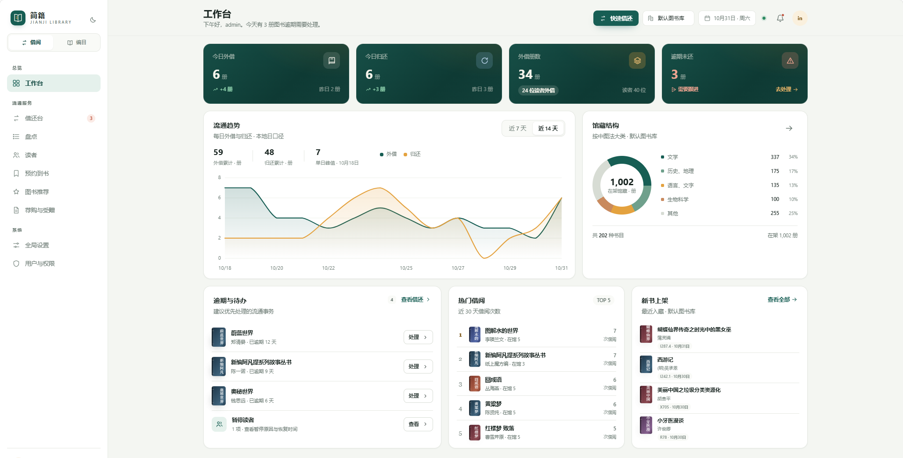
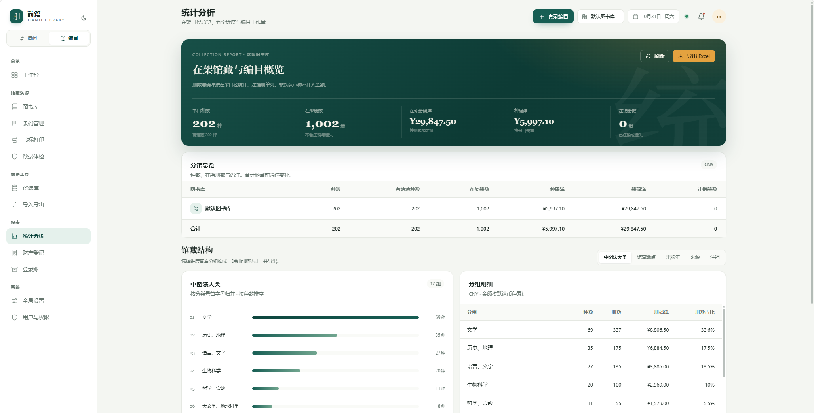
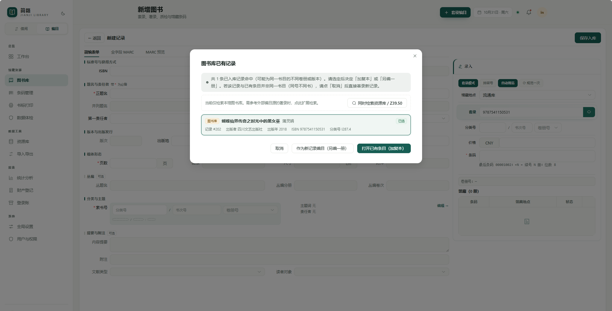

# 简籍（Jianji）中小学图书馆管理系统

> 面向中小学图书馆的编目、馆藏、流通、读者服务与统计分析一体化系统。

当前版本：`1.1.28`（见 `VERSION`）。

> 本文中「便携包」指 Release 附件 `Jianji-<版本>-portable.zip`；「内置数据库」指便携包内置的 PostgreSQL；「外部 PostgreSQL」指部署方自行提供的数据库。

---

## 功能

| 领域 | 能力 |
| --- | --- |
| 编目 | CNMARC 著录与套录（Z39.50、本地资源库、外部 PostgreSQL）、ISBN 与 ISBD 规范化、索书号与书次号生成、中图法分类、编目质检 |
| 流通 | 外借、归还、续借、逾期罚款、预约到书、图书转库、盘点、遗失赔偿 |
| 馆藏 | 条码管理、书标打印、馆藏地点与状态管理 |
| 读者 | 读者档案、读者账号与读者门户（检索、我的借阅、座位预约） |
| 数据 | ISO 2709 与 Excel 导入导出、后台批处理、数据体检、财产登记、统计分析 |
| 系统 | 角色与模块权限、接口凭据、操作日志与审计 |
| 集成 | MCP 服务器（可选，需另装 MCP 依赖），供支持 MCP 的客户端查询书目与执行导入导出 |

---

## 界面预览

> 截图为演示环境截图，数据仅用于展示；截图中的示例数据不随便携包提供。

**工作台**：今日外借与归还、外借中与逾期、近 14 天流通趋势、馆藏结构、逾期待办、热门借阅与上新。



**统计分析**：在架馆藏与编目概览、分馆总览，以及按中图法、馆藏地、语种、来源的结构分布，可导出 Excel。



**编目查重**：录入 ISBN 即查重；命中已有书目时可并入已有书目并增加复本，也可另建新记录。



**读者门户**：读者自助检索、新书上架、分级推荐、借阅榜与最近动态；手机浏览器使用同一套页面，无需安装应用。


---

## 系统要求

| 依赖 | 版本 | 何时需要 |
| --- | --- | --- |
| PostgreSQL | 17.8（便携包内置） | 内置数据库模式无需安装；外部 PostgreSQL 模式需 15 及以上 |
| Python | 3.13.14（便携包内置） | 内置数据库模式无需安装；自行安装 Python 时需 3.12 及以上 |
| YAZ（yaz-client） | 5.x | 仅在使用 Z39.50 套录时需要 |
| Windows | 10 / 11 x64 | 内置数据库模式 |

便携包从 GitHub/Gitee 的 Releases 页面下载。Linux 与 macOS 继续使用外部 PostgreSQL，数据库管理详见 `docs/升级与回滚手册.md`。

---

## 部署

### 1. 解压并启动

1. 从 GitHub/Gitee 的 Releases 页面下载 `Jianji-<版本>-portable.zip`，解压到**可写目录**。不要放 `Program Files`、只读盘或网络共享。
2. 双击根目录的 `JianjiLauncher.exe`。
3. 首次启动会自动创建 `data\pgdata`、初始化数据库并打开网页；不需要安装 Python 或 PostgreSQL，也不需要 `pip install`。
4. 浏览器访问 `http://127.0.0.1:8000`，按页面提示创建管理员。
5. 首次访问完成管理员创建后，再按需启用局域网访问。

便携包内已包含 Python 3.13.14、PostgreSQL 17.8、后端依赖和启动器。程序目录不可写时启动器会明确报错，请换到普通用户可写目录。

### 2. 局域网访问

在启动器运行页勾选「局域网访问」，重启服务后其他电脑通过 `http://<主机内网地址>:<端口>` 使用简籍网页。

- 数据库只监听主机本机，局域网共享的是网页，不要尝试从其他电脑连接 `55432`；
- 首次使用请先在主机本机完成管理员创建，再开放局域网；
- Windows 防火墙提示时选择允许，或按启动器日志手动放行后端端口。

### 3. 外部 PostgreSQL（可选）

如部署方已有 PostgreSQL，可在数据库页关闭内置数据库开关，填写主机、端口、库名、用户和口令。初始化要建表并执行 `CREATE EXTENSION pg_trgm`，后续升级还要执行 Alembic 迁移，因此需要 DDL 与扩展创建权限；建议由 PostgreSQL 管理员执行初始化与升级，业务账号只负责日常运行。

数据库口令建议写入 `%APPDATA%\postgresql\pgpass.conf`，也可以使用环境变量 `JIANJI_DB_PASSWORD` 或完整连接串 `JIANJI_DATABASE_URL`。

### 4. 首次登录

首次访问时系统会提示创建管理员。请先在本机完成管理员创建，再启用局域网访问。

> 新库不预置任何外部套录源。使用 Z39.50 前，请在「全局设置 → 资源库 → 外部套录源」中自行添加可用的服务器；便携包不附带外部书目源或账号。

---

## 配置

参考 `.env.example`。后端不会自动读取 `.env` 文件，环境变量供 shell、启动脚本、systemd 或容器使用。

| 变量 | 作用 |
| --- | --- |
| `JIANJI_DATABASE_URL` | 完整连接串，优先级最高 |
| `JIANJI_DB_PASSWORD` | 仅提供口令，与默认连接串拼接 |
| `JIANJI_ACCESS_TOKEN` | 共享密钥鉴权（`X-Access-Token` 请求头），供脚本与外部程序调用 |
| `JIANJI_ACCESS_TOKEN_ROLE` | 将共享密钥绑定到角色（如 `editor`），按该角色的模块权限执行 |
| `JIANJI_CORS_ORIGINS` | 允许的前端来源，逗号分隔；不设置时只放行 localhost |
| `JIANJI_LAN_MODE` | 置 `1` 表示本次对外监听；启动器启用局域网访问时自动注入 |
| `JIANJI_SERVE_STATIC` | 置 `0` 关闭「后端托管 frontend/dist」 |
| `JIANJI_DB_STATEMENT_TIMEOUT` | 语句超时，默认 `600s`；另有 `JIANJI_DB_LOCK_TIMEOUT`、`JIANJI_DB_IDLE_TIMEOUT` |
| `JIANJI_SESSION_DAYS` | 登录会话有效期，默认 30 天 |
| `JIANJI_YAZ_CLIENT` | `yaz-client` 可执行文件路径，仅 Z39.50 套录需要 |

> `JIANJI_ACCESS_TOKEN` 仅用于受控的脚本或外部集成，请妥善保管并限制访问来源。多用户部署建议使用界面中的「接口凭据」，可按角色授权并逐次审计。

---

## 分类与数据

便携包使用 22 个中图法一级大类，用于统计分组和读者门户分类标签。

分类号本身按字符串著录：可以手工录入，也可以由 Z39.50 套录带入 690，不要求存在于参考表。

- 22 个一级大类（自写，据《中图法》第五版基本大类整理）；
- 106 个常用 CNMARC 字段（按 GB/T 33286—2016 校对；905 等子字段按本系统馆藏需要扩展）；
- 常用基础字典（语种、文献类型、获得方式、付款方式、责任方式等）。

详见 [`DATA_NOTICE.md`](DATA_NOTICE.md)。

---

## 备份、升级与回滚

```bat
if not exist backups mkdir backups
runtime\pgsql\bin\pg_dump.exe -h 127.0.0.1 -p 55432 -U postgres -Fc jianji > backups\jianji_YYYYMMDD.dump
runtime\pgsql\bin\pg_restore.exe -h 127.0.0.1 -p 55432 -l backups\jianji_YYYYMMDD.dump > nul && echo 备份可读
```

回滚方式为「整目录换回 + 整库还原」。不要使用 `alembic downgrade` 作为生产回滚手段。

完整流程与部署注意事项见 [`docs/升级与回滚手册.md`](docs/升级与回滚手册.md)。

---

## 目录结构

```text
VERSION                  当前版本号
LICENSE                  GNU Affero General Public License v3.0
NOTICE                   版权与许可声明
THIRD_PARTY_NOTICES.md   第三方组件许可声明
DATA_NOTICE.md           内置数据声明
JianjiLauncher.exe       启动器（Windows）
docs/                    部署与运维文档
runtime/
  python/                内置 Python 3.13.14 与后端依赖
  pgsql/                 内置 PostgreSQL 17.8 最小运行时
backend/
  app/                   后端代码与内置数据
  migrations/            数据库迁移链（Alembic）
  scripts/               初始化、内置数据库与数据库维护脚本
  app/data/              最小自写数据（22 类简表、常用字段、基础字典）
  requirements.lock.txt  运行依赖（精确锁定）
frontend/
  dist/                  已构建的前端产物（后端直接托管）
data/                    首次启动创建：pgdata、launcher-config.json
backups/                 自动备份目录
```

`data/` 是现场运行数据，不随便携包提供。

---

## 常见问题

**登录页提示「请先创建管理员」**：数据库中尚无馆员账号，按页面提示创建即可。

**接口一律返回 403**：检查当前角色是否具备对应模块的权限；新增接口需要在后端登记模块。

**端口被占用**：启动器会显示占用进程名与 PID，可更换端口或结束该进程。

**数据库连接失败**：按「PostgreSQL 服务是否启动 → 数据库是否存在 → 口令是否正确」依次排查。中文 Windows 上 PostgreSQL 的报错为 GBK 编码，后端已转换为中文提示。

**Z39.50 检索无结果**：确认目标源可达；国内源多为 GBK 编码，字符集选择错误会导致 0 命中且不报错。按 ISBN 能查到、按题名查不到，通常属于字符集配置问题。

**输入 ISBN 没有自动带出出版者/出版地**：请使用 Z39.50 套录（210 字段会带入出版者与出版地），或手工填写。

**内置数据库启动失败**：确认程序目录可写；查看 `data\postgresql.log` 与 `launcher-logs\launcher.log`。不要把程序放在 `Program Files`；升级前备份整个 `data/` 与 `backups/`。

**局域网其他电脑打不开**：只开放后端端口；检查启动器「局域网访问」是否已重启生效，以及 Windows 防火墙是否允许。

**杀毒软件拦截**：便携包内含 Python/PostgreSQL 未签名二进制，请核对 Release 附件的 SHA256 后放行；不要从非官方来源下载。

---

## 自检

```bash
curl http://127.0.0.1:8000/api/health
```

期望返回：

```json
{"status":"ok","db":true,"version":"1.1.28","schema_ok":true}
```

- `db:false`：数据库未连接；
- `schema_ok:false`：数据库结构落后于程序版本，请使用启动器的「升级数据库」或执行 `runtime\python\python.exe -m alembic -c backend\alembic.ini upgrade head`。

---

## 许可证

本项目采用 [GNU Affero General Public License v3.0](LICENSE) 发布。

- 允许商业使用、修改与分发；
- 通过网络向用户提供服务时，须按 AGPL 提供对应源代码；
- 第三方组件许可见 [THIRD_PARTY_NOTICES.md](THIRD_PARTY_NOTICES.md)；
- 内置数据不在本许可范围内，见 [DATA_NOTICE.md](DATA_NOTICE.md)；
- 版权归著作权人所有，具体条款以 `LICENSE` 为准。

Copyright (c) 2026 zhaocibaidi233. All rights reserved.
